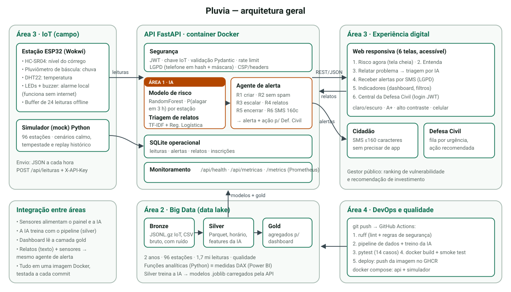

# Pluvia: previsão de alagamentos com IoT e IA

**Global Solution 2026/2 · CitizenTech · FIAP · Engenharia de Software (4ESOA)**

O Pluvia avisa o morador **antes** de o córrego transbordar. Estações IoT (uma em cada um dos **96 distritos de
São Paulo**) medem chuva e nível da água. Uma IA calcula a chance de alagar nas próximas 3 horas. Um agente de
automação decide quando alertar a população por SMS e orienta a Defesa Civil. O cidadão também pode relatar
problemas em texto livre, que outra IA classifica e encaminha ao órgão certo. Um dashboard mostra ao gestor
público onde investir em prevenção.

> **Resultado medido:** no teste com 1 ano de dados que o modelo nunca viu (356 alagamentos), a IA avisou
> **96% dos alagamentos com 1 hora ou mais de antecedência**, contra 64% do método atual (alarme quando o córrego
> atinge 80% do limite). A antecedência média passou de 39 para **92 minutos**, e os falsos alarmes caíram de 28
> para **13 por mês** na cidade toda.

| | |
|---|---|
| **Demo online** | **https://pluvia-vercel.vercel.app/**: as 6 telas funcionando sem instalar nada. Roda no navegador com os mesmos modelos de IA do projeto. Na tela "Risco agora", use o botão **"Simular temporal"** (detalhes em [`vercel/README.md`](vercel/README.md)) |
| **Documento de entregáveis** | [`docs/Pluvia_Entregaveis.pdf`](docs/Pluvia_Entregaveis.pdf) (também em `.docx`) |
| **Vídeo pitch** | `<link do vídeo>` (também em `integrantes.txt`) |
| **Integrantes** | Lúcia Inês Boutti (RM97911) · Thiago Eiji Matumoto (RM97711) · Pedro Eugênio Bezerra de Meneses Arruda (RM98227) · Matheus Matos Bernardo (RM99340) · Murilo Alves Mansano (RM98143) |
| **ODS** | 11 (cidades resilientes) · 13 (clima) · 9 (infraestrutura) · 10 (desigualdades) |

---

## 1. Onde verificar cada critério

| Área (pontos) | Requisito do enunciado | Onde está | Como conferir |
|---|---|---|---|
| **IA e automação (4)** | IA aplicada | `ia/risco.py` (RandomForest), `ia/triagem.py` (NLP) | Tela **Relatar** ou `POST /api/ia/triagem` em `/docs` |
| | Prompts, agentes ou automação | `ia/automacao.py` (agente com regras R1–R6) | Rodar o simulador e ver os alertas na **Defesa Civil** |
| | Demonstração com entrada e saída | `docs/evidencias/simulador_tempestade.txt` | Seção 3 do roteiro abaixo |
| | Lógica e ganho (antes x depois) | `ia/treinar.py` → `ia/modelos/metricas.json` | Tela **Indicadores**, tabela "A IA avisa melhor que o método atual?" |
| **Big Data (4)** | Estrutura dos dados | Data lake `bigdata/data/{bronze,silver,gold}` | Gerado por `python -m scripts.preparar` |
| | Ingestão e processamento | `bigdata/gerar_dados.py` → `bigdata/pipeline.py` | `bigdata/data/gold/qualidade.json` |
| | Dashboard com 3+ indicadores e filtros | Tela **Indicadores** (8 KPIs, 4 gráficos, filtros) | Filtrar por região, distrito e período |
| | Funções analíticas | `bigdata/analitico.py` + equivalentes DAX em `bigdata/medidas_dax.md` | Índice de vulnerabilidade, média móvel, ranking |
| **MVP, IoT e experiência (4)** | 4+ telas funcionais | `frontend/` (6 telas) | http://127.0.0.1:8000 |
| | 2+ sensores | `iot/estacao_pluvia/` (ESP32 no Wokwi: HC-SR04, pluviômetro, DHT22) + `iot/simulador.py` | Wokwi (seção 5.3) ou simulador |
| | Fluxo funcional completo | Sensor → IA → agente → alerta → tela/SMS | Roteiro da seção 3 |
| | Diagrama de arquitetura | [`docs/arquitetura.svg`](docs/arquitetura.svg) | Também no PDF, seção 2 |
| **DevOps e qualidade (3)** | Organização e Git | Pastas por área (seção 7) | Histórico de commits |
| | Docker, CI/CD, monitoramento | `Dockerfile`, `docker-compose.yml`, `.github/workflows/ci.yml`, `/metrics` | `docs/evidencias/docker_run.txt`, print do pipeline no PDF |
| | 2+ práticas de segurança | `app/seguranca.py`, `app/schemas.py` (7 práticas, seção 5.4) | Testes CT-02 a CT-10 e CT-14 |
| | Plano com 5+ testes | [`docs/plano_de_testes.md`](docs/plano_de_testes.md) (14 casos) | `pytest` → `docs/evidencias/pytest.txt` |

---

## 2. Como rodar (cerca de 5 minutos)

> **Só quer ver funcionando?** Abra a demo online em **https://pluvia-vercel.vercel.app/**, sem instalar nada.
> Ela roda no navegador com os mesmos modelos de IA. Para avaliar o sistema completo (API, banco, segurança,
> testes e Docker), siga os passos abaixo.

**Pré-requisito:** Python 3.11 ou superior (testado em 3.12 e 3.14). Todos os comandos são executados na raiz do projeto.

**1) Criar um ambiente e instalar as dependências**

```bash
python -m venv .venv
```

Ative o ambiente com `.venv\Scripts\activate` (Windows) ou `source .venv/bin/activate` (Linux/macOS). Depois:

```bash
pip install -r requirements-dev.txt
```

**2) Configuração de demonstração**

```bash
cp .env.example .env
```

(no Windows sem Git Bash: `copy .env.example .env`)

**3) Gerar os dados e treinar a IA** (cerca de 1 minuto)

```bash
python -m scripts.preparar
```

Gera 2 anos de dados das 96 estações (1,7 milhão de leituras), passa pelo pipeline bronze → silver → gold,
treina os dois modelos e grava as métricas em `ia/modelos/metricas.json`. Os dados são sintéticos, com semente
fixa: o resultado é sempre o mesmo.

**4) Subir o sistema**

```bash
uvicorn app.main:app --env-file .env --host 127.0.0.1
```

- Site: **http://127.0.0.1:8000**
- Documentação interativa da API: **http://127.0.0.1:8000/docs**
- Login da área da Defesa Civil (demonstração): usuário `defesacivil`, senha `demo-DefesaCivil-2026` (definidos no `.env`)

> No Windows, use `127.0.0.1` em vez de `localhost`: com `localhost` cada requisição pode demorar ~200 ms a mais
> (o sistema tenta IPv6 antes do IPv4).

**5) Simular um temporal** (em outro terminal, com o ambiente ativado)

```bash
python -m iot.simulador --cenario tempestade --bairro "Jardim Helena"
```

Cada ciclo representa 1 hora de leitura das estações. Outros cenários: `--cenario calmo` e
`--cenario replay` (reproduz o maior alagamento do histórico do distrito).

**Testes e lint**

```bash
pytest
```

```bash
ruff check .
```

**Alternativa com Docker** (depois do passo 2):

```bash
docker compose up --build
```

Para subir junto o simulador de temporal: `docker compose --profile demo up --build`. A imagem gera os dados e
treina a IA durante o build.

---

## 3. Roteiro sugerido de avaliação (10 minutos)

1. Abra **Risco agora** (http://127.0.0.1:8000). Escolha o distrito **Jardim Helena**. A tela mostra o córrego
   como um "copo" de água, a chance de alagar e o que fazer. Role a página para ver o **mapa de calor** com os 96 distritos.
2. Abra **Alertas por SMS** e cadastre um telefone fictício para o Jardim Helena. O número é guardado só como hash e máscara (LGPD).
3. No terminal, rode o simulador de temporal (passo 5). Volte à tela **Risco agora** e acompanhe:
   - com o córrego em **64% do limite**, a IA calcula ~53% de chance e o agente emite **ALERTA** (2 horas antes do transbordamento);
   - na hora seguinte, o risco sobe e o alerta é escalado para **EMERGÊNCIA**;
   - quando a chuva para e o nível baixa, o alerta é encerrado.
4. Em **Relatar**, escreva algo como "a água do córrego entrou nas casas e tem um idoso ilhado". A IA classifica
   tipo, urgência, órgão responsável e prazo em poucos milissegundos.
5. Entre na **Defesa Civil** (login acima): fila de relatos ordenada por urgência, decisões do agente com as
   regras aplicadas e saúde do sistema.
6. Em **Indicadores**, filtre por região e período. Veja a recomendação ao gestor, os 8 indicadores e a
   comparação **antes x depois** da IA.
7. Em **Entenda**, veja como o sistema explica cada número ao cidadão e use o simulador "faça chover".
8. Em **/docs**, teste os endpoints diretamente (por exemplo, `POST /api/ia/triagem`).

---

## 4. Como funciona



1. **Estação IoT** (ESP32 ou simulador) envia a leitura da hora para `POST /api/leituras`, autenticada com a chave `X-API-Key`.
2. A **API** (FastAPI) valida os dados e monta as variáveis da IA com as últimas 24 leituras daquela estação
   (chuva da hora, chuva em 3 h e 24 h, nível, variação do nível, % do limite).
3. O **modelo de risco** calcula a chance de transbordar nas próximas 3 horas. Sem chuva nas últimas 24 h e com o
   córrego abaixo de 50% do limite, o risco é zero por definição e o modelo nem é chamado.
4. O **agente de alerta** aplica as regras R1–R6 (criar, não repetir, escalar, considerar relatos graves,
   encerrar, mensagem de até 160 caracteres) e registra o alerta e o número de SMS que seriam enviados.
5. As **telas** consultam a API a cada poucos segundos (só quando a aba está visível).
6. O histórico forma o **data lake**: bronze (bruto) → silver (limpo, Parquet, com as variáveis da IA) → gold
   (agregados). A silver treina a IA e a gold alimenta o dashboard.

---

## 5. Detalhes por área

### 5.1 IA e automação
- **Previsão de alagamento:** RandomForest com 6 variáveis físicas dos sensores. Treino no 1º ano, teste no 2º.
  O limiar de alerta (0,35) foi escolhido por validação cruzada só nos dados de treino. Hora do dia e mês foram
  testados e descartados, porque o modelo "decorava" o horário dos temporais.
- **Triagem de relatos:** TF-IDF (palavras e trechos de palavras, tolerante a erros de digitação e falta de acento)
  com Regressão Logística para categoria e urgência. Regras de segurança forçam urgência alta em expressões de
  risco à vida ("ilhado", "correnteza", "desabou"...). Com menos de 60% de confiança, o relato vai para revisão humana.
  Acerto em 20 frases escritas à mão, fora da base de treino: 95% na categoria e 85% na urgência.
- **Agente de automação:** `ia/automacao.py`, com as mensagens de SMS e as ações recomendadas à Defesa Civil.
  A solução não depende de LLM: roda sem internet, sem custo por uso e responde em milissegundos.

### 5.2 Big Data e visualização
- **Bronze:** `leituras_iot.jsonl.gz` (1,69 milhão de linhas, com defeitos propositais: nulos, leituras
  impossíveis, duplicatas, IDs inconsistentes), ocorrências da Defesa Civil e 4.000 relatos.
- **Silver:** série horária limpa por estação em Parquet (deduplicação, validação de faixa física, interpolação
  de lacunas curtas, variáveis da IA). O relatório de qualidade fica em `gold/qualidade.json`.
- **Gold:** fatos diários e mensais por distrito, dimensão distrito e relatos por categoria. Prontos para o
  dashboard web ou para o Power BI (fórmulas DAX em `bigdata/medidas_dax.md`).
- **Dashboard:** 8 indicadores, 4 gráficos, ranking dos 96 distritos e recomendação automática de onde investir.

### 5.3 MVP, IoT e experiência digital
- **6 telas:** Risco agora, Entenda, Relatar, Alertas por SMS, Indicadores e Defesa Civil.
  Responsivas, com tema claro e escuro, fonte ampliada, alto contraste e animações que respeitam quem prefere menos movimento.
- **Estação física (Wokwi):** abra um projeto ESP32 em https://wokwi.com, cole
  `iot/estacao_pluvia/estacao_pluvia.ino` e `iot/estacao_pluvia/diagram.json` e adicione a biblioteca
  "DHT sensor library for ESPx". Mova o controle de distância do HC-SR04 (distância menor = córrego mais cheio) e
  clique no botão verde para simular chuva. LEDs e buzzer funcionam como **alarme local, mesmo sem internet**,
  e as leituras ficam em buffer até a conexão voltar. Para enviar à API local é preciso o Wokwi Private Gateway.
- **Simulador:** `iot/simulador.py` reproduz as 96 estações com o mesmo protocolo do ESP32 e envia a região do temporal.

### 5.4 DevOps, segurança e qualidade
- **Docker:** imagem `python:3.12-slim` que gera dados e treina a IA no build, roda sem privilégios de administrador e tem healthcheck.
- **CI/CD (GitHub Actions):** a cada push, roda o lint (com regras de segurança), o pipeline de dados e o treino,
  os 14 testes, o build com teste rápido do container e, na branch `main`, publica a imagem no GitHub Container Registry.
- **Monitoramento:** `/api/health`, `/api/metricas` e `/metrics` (formato Prometheus).
- **Segurança (7 práticas):** login JWT com expiração; senha guardada com hash PBKDF2; chave para os
  dispositivos IoT; validação de todas as entradas; telefone protegido (LGPD, só hash e máscara); limite de envios
  por minuto; cabeçalhos HTTP de segurança e erros sem detalhes internos.
- **Testes:** 14 casos automatizados, descritos em `docs/plano_de_testes.md`.

---

## 6. Ferramentas e para que servem

| Ferramenta | Para que usamos |
|---|---|
| Python | Linguagem principal: dados, IA e servidor |
| FastAPI + Uvicorn | API que recebe as leituras dos sensores e atende as telas; gera a documentação em `/docs` |
| Pydantic | Confere tudo que chega à API antes de aceitar (valores impossíveis, textos maliciosos) |
| SQLite | Banco de dados da operação (leituras, alertas, relatos, inscrições) em um único arquivo |
| pandas, NumPy, SciPy, PyArrow | Geração e limpeza de 1,7 milhão de leituras, Parquet e indicadores |
| scikit-learn, joblib | Treino e uso dos dois modelos de IA |
| HTML, CSS, JavaScript + Chart.js | As 6 telas e os gráficos, sem framework pesado, para abrir rápido até em celular simples |
| ESP32, HC-SR04, pluviômetro, DHT22 (Wokwi) | Estação de medição no córrego, com alarme local |
| Docker e Docker Compose | Rodar o sistema igual em qualquer máquina com um comando |
| GitHub Actions | Pipeline automático de lint, testes, build e publicação |
| pytest e Ruff | Testes automatizados e verificação de qualidade e segurança do código |
| PyJWT | Token de acesso da Defesa Civil (expira em 60 minutos) |

---

## 7. Estrutura do projeto

| Pasta | Conteúdo |
|---|---|
| `ia/` | Treino e uso dos modelos, triagem de relatos, agente de alerta, frases de validação manual |
| `bigdata/` | Catálogo dos 96 distritos, gerador de dados, pipeline bronze/silver/gold, funções analíticas, DAX |
| `iot/` | Estação ESP32 para o Wokwi (`estacao_pluvia/`) e simulador das estações |
| `app/` | API FastAPI: rotas, segurança, validação, banco |
| `frontend/` | As 6 telas (HTML, CSS, JavaScript) |
| `tests/` | 14 testes automatizados |
| `scripts/` | `preparar.py` (dados + IA) e captura de telas |
| `docs/` | Entregáveis (PDF/DOCX), arquitetura, plano de testes, evidências e prints |
| `.github/workflows/` | Pipeline de CI/CD |

## 8. Principais endpoints

| Método | Rota | Acesso |
|---|---|---|
| POST | `/api/leituras` | Estação IoT (`X-API-Key`) |
| GET | `/api/bairros`, `/api/catalogo`, `/api/bairros/{distrito}/historico`, `/api/alertas` | Público |
| POST | `/api/relatos` (com triagem por IA), `/api/inscricoes`, `/api/ia/triagem` | Público (com limite de envios e LGPD) |
| POST | `/api/auth/login` | Retorna o token JWT |
| GET / PATCH | `/api/relatos`, `/api/relatos/{id}`; POST `/api/admin/reset` | Defesa Civil (JWT) |
| GET | `/api/dashboard?regiao=&bairro=&inicio=&fim=`, `/api/ia/metricas` | Público |
| GET | `/api/health`, `/api/metricas`, `/metrics` | Monitoramento |

## 9. Observações
- Todos os dados são **sintéticos** e reprodutíveis (semente fixa). Distritos e populações aproximadas servem de
  cenário; em produção o modelo seria re-treinado com séries reais (ex.: CGE-SP, Cemaden).
- O envio de SMS é **simulado**: o sistema registra quantos inscritos receberiam cada alerta.
- Projeto original do grupo, construído com bibliotecas de código aberto (FastAPI, pandas, scikit-learn, PyJWT, Chart.js, DHTesp).
